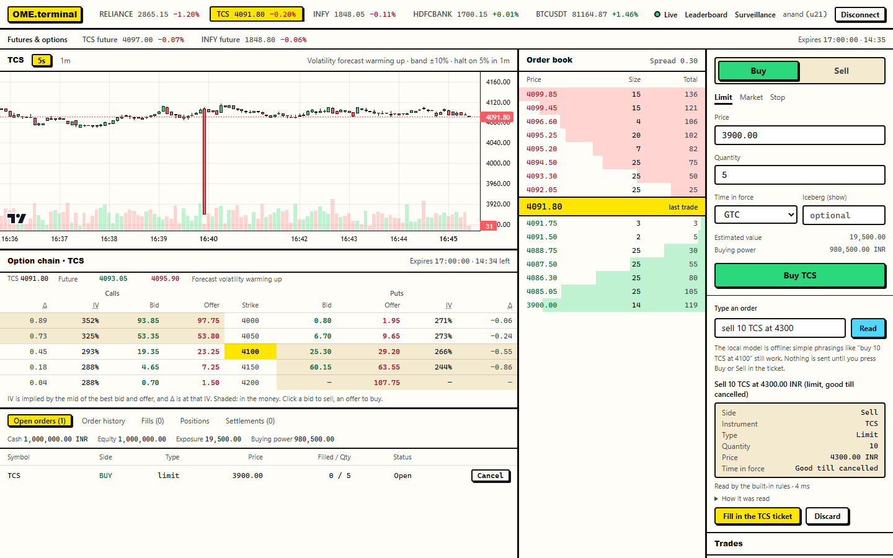
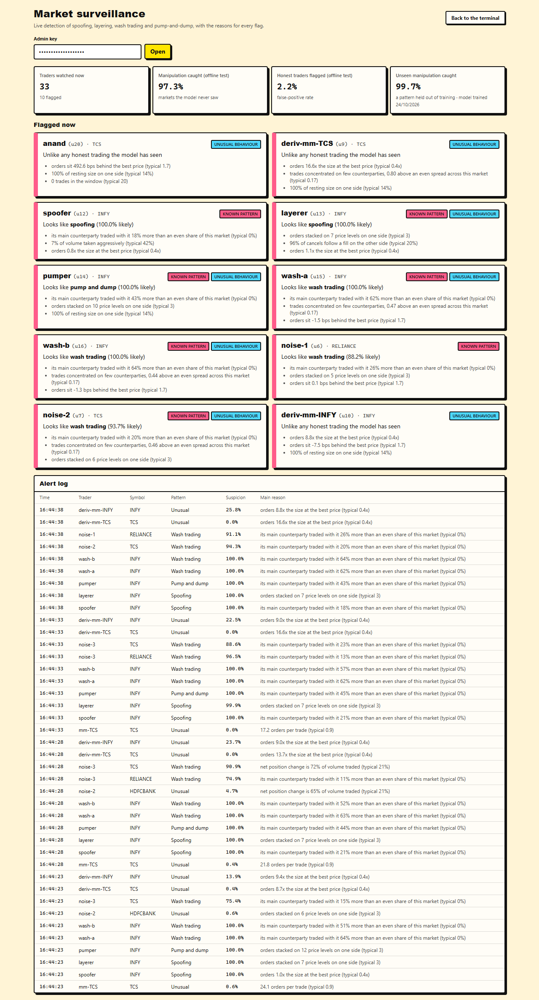

# Order Matching Engine

A stock-exchange simulator built from scratch in TypeScript: a price-time priority matching engine (also ported to Rust and WebAssembly), a live trading terminal, futures and options, trading tournaments, trading bots, a backtester on real market data, plain-English orders read by a local language model, and AI-based market surveillance.



*The terminal during a live session (Neo-Brutalism theme): the TCS chart with its volatility readout, the order book, the TCS option chain, and a typed order ("sell 10 TCS at 4300") read into a proposal that is sent only after you confirm.* Stills from the narrated demo: [market](docs/demo-market.png), [volatility](docs/demo-volatility.png), [option chain](docs/demo-option-chain.png), [two traders](docs/demo-two-traders.png), [circuit-breaker halt](docs/demo-halt.png), [plain-English order](docs/demo-plain-english.png), [surveillance](docs/demo-surveillance.png), [leaderboard](docs/demo-leaderboard.png). The 3½-minute video itself is kept out of the repository for size; `pnpm --filter @ome/terminal demo` records it (see TESTING.md).

## Status

| Milestone | State |
|---|---|
| Matching engine core (limit, market, IOC, FOK, cancel, amend) | Done |
| Differential + property-based test suite | Done |
| Benchmarks (orders/sec, p99 latency) | Done |
| GC investigation: fixed unbounded id memory, GC-neutral benchmark harness | Done |
| Stop-loss / stop-limit (with cascades), iceberg orders, self-trade prevention | Done |
| Write-ahead journal, group commit, snapshots, crash recovery | Done |
| Multi-symbol exchange: worker-thread shards, lock-free SPSC ring buffers, binary codec | Done |
| WebSocket/REST gateway: sessions, validation, rate limits, private execution reports, market data | Done |
| Bots: inventory-skewed market maker, noise traders, live Binance BTC/USDT follower, record & replay | Done |
| Trading terminal (Next.js 16): live book, candles, order ticket, orders, fills, positions | Done |
| Call auctions (max-volume uncross), opening auction, circuit breakers, price bands | Done |
| Accounts, buying-power checks, fat-finger limits, margin liquidation | Done |
| AI market surveillance: spoofing, layering, wash trading, pump-and-dump (LightGBM + Gaussian mixture, ONNX in Node) | Done |
| AI: volatility forecasting on real BTC data (five models, walk-forward selection); volatility-aware bands, breakers and quoting | Done |
| AI: RL market maker (PPO), beats Avellaneda-Stoikov offline and live through the real gateway | Done |
| Surveillance shadow mode: per-market calibration on honest live traffic, with measured safety caps | Done |
| Primary/replica replication with automatic failover and epoch fencing (SIGKILL-tested) | Done |
| Typed-array order storage: 5.5x lower worst-case pause | Done |
| Futures and options: Black-Scholes pricing, rolling expiries, VWAP cash settlement, margin, a delta-hedging options market maker, an option chain | Done |
| Trading tournaments with a live leaderboard | Done |
| Plain-English orders read by a local LLM (Ollama, qwen2.5), every answer checked against the text | Done |
| Backtester: the live bots' own code on real Binance trades, with paired window comparisons | Done |
| Rust/WebAssembly matching engine, byte-identical events to the TypeScript engine; `ENGINE=rust` in the live exchange | Done |
| Gateway scaling: coalesced writes, multi-process front-ends (`GATEWAY_PROCESSES`) | Done |
| Docker / docker-compose | Done (built and smoke-tested in CI on Linux) |

## Design

- **Price levels** are stored in AVL trees: bids sorted high to low, asks low to high. The best price is always the tree's minimum, found in O(log L).
- **Orders at one price** form a FIFO doubly-linked list, so the first order in gets filled first.
- **An order-id index** makes cancel and amend O(1) once the order is found.
- **Trades execute at the resting order's price**, so the taker gets any price improvement.
- **Every call returns events stamped with a sequence number**, so identical inputs always replay to identical outputs. Crash recovery will build on this.
- **Prices and quantities are integers** (ticks and units), so there are no floating-point rounding errors.
- **Stop orders** wait in their own AVL trees keyed by stop price. When a trade prints through a stop, it enters the book; its own trades can trigger further stops (a cascade). Stops that trigger together run in arrival order.
- **Iceberg orders** show one slice at a time. When a slice fills, the next one joins the back of the queue, so hidden size never jumps ahead of visible orders.
- **Self-trade prevention:** the incoming order chooses `cancel_taker`, `cancel_maker`, `cancel_both` or `allow`. A FOK order accounts for this up front: it only counts the liquidity that can really fill before matching would reach the trader's own order.
- **Call auctions.** In the auction phase, limit orders collect without matching, so the book may cross. `uncross` then trades everything possible at **one equilibrium price**, which:
  1. maximizes traded volume,
  2. then minimizes the leftover imbalance,
  3. then sits closest to the last price,
  4. then is the lowest.

  These are the NSE pre-open rules. One sweep over the levels between best ask and best bid computes demand `D(p)` and supply `S(p)` incrementally. Iceberg reserves count, and their slices refill during the uncross. Stops fire after the uncross, in continuous trading.
- **Phase changes are commands** (`start_auction`, `uncross`). They are ordered with the orders around them, journaled and replayed, so recovery reproduces every halt exactly.

## Durability (`packages/journal`)

The engine has no clocks and no randomness, so **the same commands always produce the same state**. Durability therefore journals *inputs*, not outputs, as LMAX-style exchanges do:

- **Write-ahead journal:** every command is appended to the journal *before* the engine applies it. Each record is one line, `<crc32> <json>`, so half-written or bit-flipped records are always detected.
- **Recovery:** load the newest valid snapshot, then replay the journal after it.
  - A bad record at the very end is a torn write from a crash, so it is cut off.
  - A bad record *with good data after it* is real corruption. Recovery stops with an error instead of silently dropping commands that were already acknowledged.
- **Snapshots** are checksummed and written atomically (write to a temp file, fsync, rename). Each snapshot starts a new journal segment. The last two snapshots are kept, so a corrupt newest snapshot falls back to the previous one plus its journal.
- **fsync policies:** `always` (fsync per command), `batch` (**group commit**: one write and one fsync per batch, with `durableCommand` showing what is safe to acknowledge), and `never`.

| fsync policy | Commands/sec |
|---|---|
| `always` | ~3,300 |
| `batch` (100) | ~160,000 |
| `batch` (1000) | **~333,000** |
| `never` | ~160,000 |

Group commit is **~100× faster** than fsync per command, with the same guarantee for everything it acknowledges. It is even faster than `never`, because it makes one `write` system call per batch instead of one per command.

**Testing:**
- **Real crash test:** a child process runs the durable engine and is hard-killed with `SIGKILL` at uneven points, six times in a row, before and after snapshots. After each kill, recovery must contain every acknowledged command, and its state must equal an in-memory replay of the same seeded command stream.
- **Torn writes:** the journal is truncated at many byte offsets, and recovery must return exactly the commands that were complete before the cut.
- **Corruption:** a corrupt snapshot falls back to the previous one; a corrupt mid-journal record is refused.
- **Limit of the crash test:** killing a process does not lose data the OS has already accepted. Power-loss behaviour is covered by the torn-write tests and fsync ordering, not by the kill test.

## Replication and failover (`packages/replication`)

A disk survives a process crash, not a dead machine. So each book can have a **replica** on another node, kept identical by the same idea as the journal: ship the *commands*, and the deterministic engine reproduces the state.

- **Semi-synchronous replication over TCP.** The primary journals and applies each command, then streams it to the replica, which journals and applies it too. A command counts as acknowledged only when it is on disk on both nodes (one fsync per batch on each side).
- **Catch-up.** A reconnecting replica says what it has. The primary replays the rest from a backlog, or sends a snapshot if the replica is too far behind.
- **Failover.** The primary sends heartbeats. After 300 ms of silence the replica promotes itself and starts serving as primary.
- **Fencing with epochs.** Every promotion raises a persisted epoch, and nodes refuse anything from a lower one:
  - A primary that was declared dead steps down the moment it meets a newer node.
  - A replica refuses a stale primary.
  - When the old primary rejoins, it may hold commands that were applied but never acknowledged. It starts again from the new primary's snapshot, so the divergent tail is discarded.
- **Why semi-sync is the safe choice.** The replica cannot tell "the primary crashed" from "the network between us broke". If it guesses wrong and promotes while the old primary is alive, the old primary still cannot acknowledge anything, because nothing reaches its replica. So no client is ever told yes by both sides of a split. Async mode (acknowledge after the local disk only) keeps trading without a replica, but can lose the last few acknowledged commands in a failover; it is offered as an explicit trade-off.

**Testing:**
- **A real failover test.** Two node processes run the seeded command stream. Over four rounds the primary is `SIGKILL`ed mid-trading:
  - The replica must promote with **every acknowledged command**.
  - The killed node rejoins as the new primary's replica, so roles alternate.
  - At the end, both nodes' disks must equal a reference replay.
- **Checked against a planted bug.** With acknowledgement moved before replication, the test fails 3 runs out of 3; with the real code it passes 3 out of 3.
- **Unit tests:** state equality after 3,000 commands; sync mode waits for the replica; backlog and snapshot catch-up (the restored state survives a reopen); promotion with a higher epoch, but not while the primary is merely idle; fencing both ways; an old primary's unacknowledged commands are discarded on rejoin.

## Multi-symbol exchange (`packages/exchange`)

Symbols are sharded across **worker threads**, one book per symbol, so different symbols match in parallel on different cores. A symbol always lives on exactly one worker, which keeps its commands strictly ordered.

- **Lock-free SPSC ring buffers** in `SharedArrayBuffer`, one inbound and one outbound per worker:
  - `head` and `tail` are ever-increasing 32-bit word counters, and a publish is an `Atomics.store`, so message bytes are visible before the new tail is.
  - A message that would run past the end leaves a wrap marker, so every message stays contiguous.
  - The two counters sit on separate cache lines to avoid false sharing.
  - Threads sleep with `Atomics.wait`/`waitAsync`, and the busy path never makes a system call: a producer only calls `notify` when the consumer has raised a "waiting" flag.
- **Binary codec:** profiling showed **JSON was 35% of main-thread CPU**. Commands and events now use a hand-written binary format: float64 numbers, length-prefixed strings with an ASCII fast path, one-byte enums, and presence bytes for optional fields. It is round-trip property-tested, including NaN, -0 and Unicode, and absent fields stay absent. Throughput rose ~60%.
- **Ack after durable:** in durable mode, each worker drains every waiting request, journals them all, makes one fsync per book touched, and *then* replies. So a reply always means "on disk".
- **Listing while running** (`exchange.list`, `exchange.delist`), for futures and options: a new book goes to the worker with the fewest symbols, commands sent straight after a listing queue behind it, and in durable mode a relisted symbol recovers its journal.

| Workers | In memory | Durable (fsync before every reply) |
|---|---|---|
| 1 | ~470K commands/sec | ~211K |
| 2 | ~650K | ~362K |
| 4 | ~600K | **~522K (2.5×)** |
| 8 | ~525K | ~446K |

400K commands over 16 symbols, on an Intel Core Ultra 5 125H (4 performance cores + 8 efficiency cores). Run with `pnpm --filter @ome/exchange bench`.

**What the numbers show:**
- **In memory, the single main thread is the ceiling** at ~650K/sec. Matching costs ~1 µs per command, and the main thread spends about as long creating promises and encoding and decoding messages. The gateway's [multi-process mode](#scaling-the-gateway) moves the per-connection work off the main process.
- **In durable mode, sharding scales well,** because each worker fsyncs its own journals in parallel.
- Beyond 4 workers, the extra threads land on efficiency cores.

**Testing:**
- **Equivalence:** 30,000 commands interleaved across 7 symbols on 3 workers. Every symbol must produce exactly the events and final state of a single-threaded `OrderBook`. Symbols listed while running must match a single-threaded book too, while commands interleave with the listing.
- **Two real threads:** a producer thread pushes 200,000 messages through a 16 KiB ring (constant wrap-around and back-pressure), and every byte is verified in order.
- **Back-pressure:** a tiny ring caught a real bug here. Request batches could exceed the ring's maximum message size. Batches are now split, and a request too large for any message is rejected instead of crashing the process.
- **Durable restart:** state is recovered per symbol even when the worker count changes between runs, and after a delist.

## Gateway (`services/gateway`)

The network edge, built on Fastify. REST serves reference data and history; WebSocket carries trading and live market data. The gateway owns everything the engine deliberately does not:

- **Identity.** `POST /api/session` returns a token, and each WebSocket is bound to one trader by that token. The trader id on every order comes from the binding, never from the client.
- **Namespacing.** The engine order id is `<traderId>:<clientOrderId>`, so traders cannot collide with, see or cancel each other's orders.
- **Validation.** Every message is checked by a zod schema, plus tick and lot sizes. A compile-time check keeps the schemas identical to the shared wire types in `@ome/client`.
- **Rate limits.** Each connection has a token bucket (default 200 burst, 100/s; `RATE_LIMIT=off` or `RATE_LIMIT=burst,perSecond`). Client order ids must be unique per trader for the whole session; this is where session-wide uniqueness belongs, not in the engine.
- **Privacy.** Engine events name both sides of a trade. Each trader only receives private **execution reports** for their own orders; everyone else sees anonymous public trades. A test fails if any message leaks another trader's id.
- **Ordering.** A connection's commands reach the engine in the order it sent them: a cancel right behind its own order cannot overtake it (see [what scaling taught](#scaling-the-gateway)).
- **Market data.** Trades and OHLCV candles (5s and 1m) are pushed as they happen. Book depth is **conflated**: a changed symbol is marked dirty, and one depth snapshot per dirty symbol goes out every 100 ms, so a burst of 1,000 orders costs one depth query. Slow clients have market data dropped first. If even essential messages back up, the client is disconnected.

**Market protections** (`market-control.ts`):
- **Opening call auction** at startup, with a live indicative price.
- **Static price bands:** limit and stop prices more than 10% from the reference price are rejected.
- **Volatility circuit breaker:** a move of more than 5% within 60 seconds halts the symbol into a call auction, which reopens it after a cool-down. Other symbols keep trading.
  - **The move is measured from the window's low and high**, not just its oldest trade. A fall followed by a jump within the minute counts in full: 4250 → 4100 → 4320 is +5.4% from the low, though only +1.6% from the start.
  - **A reopen seeds the window with the auction price.** Recording the demo video caught a real bug here. After a halt, the window was emptied, so the first trade after the reopen became its own reference. A sweep 6.3% above the reopening price then printed eight trades without halting. A regression test reproduces that exact sequence.
  - **A bad volatility forecast (NaN) falls back to the static limits**, so it can never switch protection off.
  - **A second halt shortly after a reopen is expected behaviour.** If the auction reopens at a spike price, the fall back to fair value is itself a fast move, and the next auction lets the market makers set the price.
- **Volatility-aware limits:** once a symbol has a [volatility forecast](#ai-volatility-forecasting-packagesvolatility-servicesaivolatility), the band becomes 10 expected 15-minute moves (at least 2%), and the breaker trips on 8 expected moves within its minute (at least 1%). They only ever *tighten* the static limits, so a bad forecast cannot remove protection; the floors stop ordinary noise halting a calm market. Each symbol's status message carries the forecast and the limits in force.

**Accounts and risk** (`accounts.ts`):
- Paper cash per currency (₹10 lakh and $100k).
- Positions with average-cost P&L, marked to market.
- A pre-trade **buying-power** check (exposure ≤ leverage × equity), with resting orders counted as exposure.
- **Fat-finger** limits per order.
- Amends are checked on their increase only.
- Orders that only reduce a position never need buying power, so an account at its limit can always get out. This counts only the part of the position not already being closed by the trader's other open orders on that side.
- A once-a-second **margin check** liquidates breaching accounts: it cancels their resting orders and closes their positions at market.
- Bots act as market makers on unlimited accounts, granted by a bot key, much as exchange members differ from retail traders.

### Scaling the gateway

**Coalesced writes.** Profiling showed half the gateway's main thread in socket write system calls, one per message. Each socket is now corked on its first message of an event-loop turn and uncorked once the turn is done (`src/outbound.ts`). Each message object is serialized once, however many subscribers it goes to.

**Front-end processes (`GATEWAY_PROCESSES=N`, default 1 = one process).** N front-end processes (`src/cluster/`) do the per-connection work: WebSocket and HTTP, JSON, zod validation, per-connection rate limits, serialization, market-data fan-out and the socket writes. One core process keeps everything stateful: sessions and tokens, client order ids, accounts and risk, market control, surveillance, volatility, derivatives, tournaments and the exchange.
- **Accepting on Windows.** Node's cluster module put every connection on one worker there, and Windows has no `SO_REUSEPORT`. So the core accepts each connection (paused) and hands it to the front-end with the fewest open connections.
- **The link.** Each front-end talks to the core over a named pipe (a Unix socket elsewhere), opened with a 32-byte secret. Records are binary, batched into one length-prefixed frame per event-loop turn.
- **Same messages, same order.** Acks, rejects and execution reports are rebuilt so their JSON is byte-identical to single-process mode. `welcome` still comes first, even for messages sent before the token check finished.
- **Market data** crosses the link once per front-end and is fanned out there.
- **REST** is forwarded to the core's Fastify routes, so each route has one implementation. A browser that cancels a request (a plain-English parse waiting on the model, say) stops the work in the core too.
- Private execution reports still go only to their owner's connections, on any front-end. Duplicate client order ids are caught in the core's one event loop. A crashed front-end is restarted, and its clients reconnect with the same token.

**The old load-test figure was wrong.** Earlier versions of this README quoted ~68,000 orders/sec end to end. That load test tied each order's side to its symbol, so **its orders never traded**: every one was accepted, cancelled and acknowledged, and the load generator shared the gateway's process. The load test now runs its clients in separate processes, and its default `mix` flow trades: about 1 fill per order (both sides counted, so about 0.5 trades per order). `--flow=ioc` keeps the old no-fill flow for comparison.

| Load test: 48 clients, 20 in flight each, 6 load processes, pinned (Windows laptop, 4P+8E) | orders/sec |
|---|---|
| Trading mix, before corking | 23–25K |
| Trading mix, corked, single process | 34–36K |
| Trading mix, 1 front-end + core | 40–47K |
| Trading mix, 2 front-ends + core | **59–61K** |
| Trading mix, 4 front-ends + core | 51–59K |
| IOC only (no fills), before corking / corked / 2 front-ends | 26–30K / 42–43K / 62–66K |
| Mix + 100 market-data watchers: corked single / 4 front-ends | 4.9–5.4K (318–371K watcher msgs/s) / 7.5–8.3K (552–661K) |

Two runs per configuration, interleaved; latency in the trading mix fell from a p50 of 25–28 ms before corking to 10–11 ms corked and 7–8 ms with 2 front-ends.

**What the numbers show:**
- **Pinned, corking gave +38–55%** on the trading mix and +38–62% on IOC. **Two front-ends gave a further +64–80%** on the mix and +45–57% on IOC.
- **The link has a real cost.** With one front-end, total CPU per order is 26–30 µs against 22.6 µs in one process, so the gain comes only from running front-ends in parallel.
- **Four front-ends were no faster than two** on order flows: nothing ran above about 80% event-loop use, so the closed-loop test is bounded by latency and load generation, not by one saturated process. Only market-data fan-out kept scaling (+40–50% at N=4 over N=2).
- **Unpinned runs vary more:** 46–50K in one corked process and 68–69K with 2 front-ends; after the final fixes, shorter runs (1,000 orders per client) gave 38–40K and 50–54K.

**What building it taught:**
1. **A benchmark has to exercise the real path.** The old flow never matched an order, so it measured accept-and-cancel, not trading.
2. **Writing the ordering tests found an older bug, in both modes.** A cancel sent right behind its own limit order could reach the engine first, because the order was still awaiting its risk price. Limit and stop orders now get it synchronously, and an order that must wait (a market order that needs the book, or any order while surveillance is on) holds later commands from the same connection until it has been sent, not until the exchange answers.
3. **Review found two multi-process ordering gaps,** both fixed and tested: replies to messages held during the token check could arrive before `welcome`; and a browser abort never reached the core, because light-my-request ignores `inject`'s signal once it has read the body. An aborted plain-English parse kept its model slot until the injected reply was destroyed explicitly.

**Limitations:**
- Rate limits are per connection (and per process), not per trader.
- In multi-process mode, pong time and the rate-limit clock use the front-end's own clock, so the market-control, expiry and tournament tests (which inject a clock) run single-process only.
- Not tested in multi-process mode: the slow-consumer path (drop, then close 4008) and the link's backpressure limits.
- The balancer counts idle HTTP keep-alive connections. Each front-end takes about 1 s to start under tsx.
- Load numbers are noisy: two runs per configuration, with spreads up to about 35%.

```bash
pnpm --filter @ome/gateway loadtest                          # in-process gateway, trading mix
pnpm --filter @ome/gateway loadtest -- --gateway-processes=2  # through 2 front-ends
pnpm --filter @ome/gateway loadtest -- --watchers=100 --pin   # plus market data, pinned (Windows)
GATEWAY_PROCESSES=2 pnpm gateway                              # serve clients through 2 front-ends
RATE_LIMIT=off pnpm gateway                                   # then, in another terminal:
pnpm --filter @ome/gateway loadtest -- --url=http://127.0.0.1:8080
```

`--url` measures a running gateway. Throughput counts acks only, rejects are listed by reason, and a run with any `rate_limited` reject fails (a default `pnpm gateway` gave 34,665 of them), so start the gateway with `RATE_LIMIT=off`.

**Testing:** a codec test (every order, cancel and amend round-trips; acks, rejects and execution events rebuild to byte-identical JSON; frames split at every byte offset reassemble; corrupt frames close the link). A cluster test with three real front-end processes: fills reach only their owner, on both front-ends of a trader connected twice; 100 duplicate client ids sent at once through two front-ends give exactly one ack each; 30 subscribers spread over the front-ends get every trade once, in the same order; 200 orders each followed at once by its cancel stay in order; 10 eager connections each get `welcome` first; a browser abort through a front-end frees the trader's model slot; a crashed front-end restarts; no processes are left after close. And the black-box gateway tests run unmodified through 2 front-ends (`GATEWAY_TEST_PROCESSES=2`).

## Futures and options (`packages/pricing`, `services/gateway`, `services/bots`, `apps/terminal`)

TCS and INFY each have a **cash-settled future** and an **option chain** (calls and puts at 5 strikes around the price) on a short rolling expiry cycle: every 30 minutes by default (`DERIVATIVES_EXPIRY_MS`). When a series expires it is settled, and the next one is listed straight away. Symbols read like `TCS-25OCT1030-F` and `TCS-25OCT1030-4100C`. One contract is 10 TCS or 25 INFY shares, and prices are quoted per share.

**Pricing** (`packages/pricing`, plain JavaScript, so the browser uses it too):
- Black-Scholes for European calls and puts (rate 0 here), with delta, gamma, vega and theta in closed form.
- **Implied volatility:** Newton's method kept inside a bracket, falling back to bisection whenever a step would leave it. Deep in-the-money prices are solved as the out-of-the-money option with the same time value (put-call parity). It returns `null` when no volatility fits: a price at or outside the no-arbitrage bounds, or no time left.
- The normal CDF is accurate to about 2e-16. The usual Abramowitz-Stegun formula (1e-7) showed up in implied-volatility round trips.
- **From the forecast to an option input:** the gateway's forecast is a typical 15-minute move, annualised by square-root-of-time: 1.5% per 15 minutes is about 281% a year on a 365-day year, because the simulated market never closes.

**Listing, values and bands:**
- A future starts at the underlying's price; an option at its Black-Scholes value.
- A future's band is its underlying's band. A percentage band means nothing for an option, so its band covers every value it could have with the underlying anywhere in its band and volatility from half to double the forecast.
- Derivatives refuse orders while their underlying is in an auction, as exchanges halt derivatives with the stock.

**Margin:**
- **Futures:** nothing is paid to enter. Variation P&L is marked to the future's last trade, and each closing fill moves only the P&L it realises into cash. **Initial margin = max(5%, 6 × the forecast 15-minute move) of notional** (10% before a forecast exists): like SPAN, it scales with how far the price can move. Below two thirds of its margin, the account is closed out.
- **Options:** the buyer pays the premium. The writer receives it (the option's value is a liability in equity) and posts margin by the **CBOE uncovered-option rule**, with the futures rate in place of 20%. Options are marked at model value, so one stray trade in a thin book cannot swing an account's margin.
- Every position is margined on its own: hedged books are over-margined, never under-margined.

**Expiry and settlement:**
1. **At the expiry instant**, new orders and amends on the series are refused with `series_expired`, before the roll timer comes round: from then on the settlement price is fixed by the tape, so a trade would be a bet on a known outcome. Cancels still go through.
2. Resting orders are cancelled with reason `expired`.
3. The **settlement price** is the underlying's **VWAP over its last 60 seconds** of trades (falling back to its last trade, then its reference price). One last-second print barely moves a minute's average, which is why exchanges settle on averages.
4. Futures pay (settlement − average price) × multiplier; options pay intrinsic value × multiplier, from the writer to the holder. Each holder gets a `settlement` message saying how the price was set, and the next series is listed.

**Options market maker** (`services/bots`, on by default; `--no-derivatives` turns it off):
- Quotes every series around Black-Scholes value, using the underlying's forecast. The half-spread is the larger of 8% × volatility × vega and 5 bps × |delta| × spot.
- Leans against the book's delta; limits contracts per series, total delta and vega; clamps every quote inside the no-arbitrage bounds; requotes by amend; pulls quotes 5 s before expiry.
- **Hedges delta in the stock** with IOC orders once it passes 100 shares. Futures are quoted 3 bps around the stock.

**Terminal:** a futures-and-options bar with an expiry countdown, and an **option chain** for the selected underlying: bid and offer, the implied volatility of the mid, delta at that volatility, in-the-money strikes shaded; clicking a quote fills in the ticket. The ticket and positions show contract terms, and settlements have their own tab.

**Measured live** (`pnpm --filter @ome/bots derivatives -- --minutes=4 --cycle=60 --seed=N`): the real exchange, gateway and WebSockets in one process on a 60-second cycle, with market makers, noise traders, and two retail traders on ordinary accounts who open, partly close twice and hold positions in every series. The run is timing-driven, so a seed does not reproduce it exactly. Three runs (seeds 1–3):

| Check | Result (3 runs) |
|---|---|
| Expiries / series settled | 3–4 expiries, 58–75 series; 481 settlement messages, every one on the VWAP basis |
| Settlements vs the check's own arithmetic (VWAP from the public tape, own position, contract terms) | 481 of 481 match: 0 price, quantity or amount mismatches |
| Net cash per series over all traders | ≤ 8e-11 rupees (floating-point rounding); net contracts 0 |
| Retail cash at the gateway vs an independent ledger | equal (difference 0) for both traders, every run |
| Maker's own option quotes outside no-arbitrage bounds at the stock's mid | 0.42–0.75% of samples; executable against the stock's quotes 3–5 samples a run |
| Book's best option quotes (any trader) outside the bounds | 1.9–2.4%, mostly noise traders' limit orders going stale as the stock moves |
| Two-sided markets | future ≥ 98% of samples; at-the-money options 39–68% |
| Implied volatility of the maker's mids vs its 281% | median error 4.4–5.4%, p90 14.2–15.5% |
| Desk delta (hedge threshold 100 shares) | median 59–71 shares, max 226–855 |

**What building it taught:**
1. **The delta floor on the spread came from the live check.** Deep in-the-money options have almost no vega, so a vega-only spread put their offers below intrinsic value after the first stock move.
2. **The live check found a deadlock between bots.** A stock market maker at its position limit quotes only the side that reduces its position, and the noise traders waited for a two-sided market. In one run, delta hedging pushed the TCS maker to 521 shares (limit 500); TCS never traded again, and every later TCS expiry settled on its last trade instead of the VWAP. Noise traders now trade around whichever side exists. The same bots run in production `pnpm bots`, so it was exposed there too.
3. **Review found real margin and expiry gaps,** each now tested: a holder of one contract who sent thirty one-contract sells could open an unmargined short (now 4 of 30 are accepted, all margined), and orders could still trade between the expiry instant and the roll timer. A re-check had already found that an order whose series was delisted during its risk checks was refused as `unavailable` rather than `series_expired`.

**Limitations:** no portfolio margin offsets; accounts are in memory (in durable mode a restart relists the same series and recovers resting orders under reissued trader ids, as the spot books do); liquidating a derivative sends a market order, which does nothing on an empty option book and is retried every second; `@ome/pricing` is imported by relative path in the gateway, bots and terminal, because declaring it as a dependency needs a `pnpm install`; at-the-money options were two-sided only 39–68% of the time, and the desk's delta sometimes lags its hedge (855 shares at worst).

**Testing:**
- **Pricing:** fast-check properties over 2,000 random options each (put-call parity, bounds, monotonicity in volatility, strike and time, Greeks against finite differences, implied-volatility round trip), plus Hull's textbook examples (c = 4.76, p = 0.81) and cases deep in or out of the money and seconds before expiry.
- **Accounts:** hand-computed margins, P&L and settlements, including two successive partial futures closes and closing orders net of resting ones.
- **Gateway integration** (injected clock): two traders trade a call and a future, which settle at a VWAP of Rs 4,127.50 (±Rs 825 and ±Rs 1,100, to the paisa); trading stops at the expiry instant; a burst of one-contract sells cannot open an unmargined short.
- **Bots:** a 3,000-case property test on the maker's quotes (tick grid, uncrossed, inside the bounds, every limit respected); a real-gateway test in which the desk hedges a customer's call purchase in the stock; the noise trader trades a one-sided book.
- **Planted bugs**, each caught and undone: no expiry-time check; reducing orders ignoring resting ones; cumulative realised P&L booked; the old two-sided-only noise trader; a reversed option intrinsic value (11 amount mismatches in the live check); settling on the last print instead of the VWAP (38 price mismatches).

```bash
pnpm gateway                                   # lists TCS and INFY futures and options (DERIVATIVES=0 to turn off)
DERIVATIVES_EXPIRY_MS=120000 pnpm gateway      # two-minute expiry cycle
pnpm bots                                      # includes the options market makers (--no-derivatives to skip)
pnpm --filter @ome/bots derivatives -- --minutes=4 --cycle=60   # the live check above
```

## Trading tournaments and leaderboard (`services/gateway/src/tournaments.ts`, `apps/terminal/src/app/leaderboard`)

Traders compete over a fixed window, all starting with the same cash, and are ranked by return. Bots and market makers never rank.

**What joining does.** Joining resets the trader's **own account** to the tournament's starting cash, as a fresh account would start. The rules:
- **The account must be flat:** no position, resting order, pending stop or order in flight. Dropping a position on reset would create or destroy value out of nothing.
- **One tournament at a time**, because one account cannot be measured against two starting points. While in one, a trader can **sign up for the next**; the entry is made right after the current one's final result is taken, if the account is flat then (otherwise it lapses with a warning).
- **Joining early** resets the account at once and freezes it: orders are refused with `tournament_not_started` until the bell, including an order sent at the same moment as the join. **Joining late** is allowed: same cash, less time.
- **Unlimited accounts** (bots) are refused: they skip buying-power checks, so their returns are not comparable.

**Metrics,** per entrant, from equity sampled every second:
- **Equity:** cash plus every position at its mark (shares, futures' variation P&L, options at model value), converted to INR at a **fixed, configured rate** (`USDT_INR`, default 88). A live rate would make returns move with FX instead of trading.
- **Return**, **max drawdown** (largest fall from a running peak), **trades** (fills while live, maker or taker), and a **Sharpe ratio** of the 1-second equity returns over the tournament (not annualised), computed in constant memory with Welford's algorithm.
- **Ranking:** return, then smaller drawdown, then who joined first, then trader id.
- **Freezing:** at the end, one last sample is taken and the standings are stored. The freeze runs before the gateway applies anything stamped after the end: trader orders, engine events nobody sent directly (such as a circuit breaker's reopening uncross), expiry settlement, a forecast update and the sampling tick. A series that expires exactly at the end is valued at its mark then; its settlement cash arrives after the freeze.

| API | |
|---|---|
| `GET /api/tournaments` | Upcoming, live, and the 50 most recent finished |
| `POST /api/tournaments?key=ADMIN_KEY` | Create: `{ name, start, end, startingCash? }` (ms since epoch; cash per currency) |
| `POST /api/tournaments/:id/join` | Join with `{ token }`; 409 with `not_flat`, `unlimited_account`, `in_another_tournament`, `already_joined` or `tournament_finished` |
| `GET /api/tournaments/:id/leaderboard` | Standings, with the FX rates and `asOf` |
| WebSocket `subscribe ["leaderboard:<id>"]` | Standings every 2 s; a finished tournament's frozen result once |

`TOURNAMENT_MS=900000` runs **rolling tournaments**: back-to-back 15-minute tournaments on multiples of 15 minutes (UTC), always one live and the next open. `0` or unset means none; a value that is not a whole number of milliseconds of at least 1000 (say `15m`) stops the gateway at startup. `TOURNAMENTS=0` turns the feature off.

**Terminal:** the header's **Leaderboard** link opens `/leaderboard`: the tournaments, the live table with your row highlighted, and a **Join** button that explains the reset (or signs you up for the next one). It uses client-side navigation, so the trading session and its WebSocket carry over and standings arrive by push.

**What building it taught:**
1. **A tolerance is not a comparison.** Treating returns within 1e-6 points as equal gave 5 different rankings of one 6-entry field depending on input order, because a ≈ b and b ≈ c does not mean a ≈ c. Returns are now rounded to a fixed grid before comparing, and a property test ranks 500 seeded fields of near-ties identically under 20 shuffles.
2. **A race let an order fill before the bell.** A market order sent while its trader joined an upcoming tournament filled early in 1 of 60 trials; it is now refused (0 of 60), and the test forces the race deterministically.
3. **Whether settlement counted depended on an unrelated resting order** when a future expired at the instant a tournament ended. Now nothing after the end counts.
4. **Planted bugs found an untested path.** Removing the freeze on engine events at first passed every test, because trader orders freeze through another path; a test now forces a circuit-breaker uncross at the end. One freeze is still uncovered: the one at the start of the 1-second timer, which only guards option values against a forecast update after the end.

**Limitations:** tournaments and results are in memory and lost on a gateway restart; identity is per session, so a reconnecting trader is a new entrant; there is no "leave"; creating a tournament is REST-only; the default starting cash (₹10 lakh + $100,000, about ₹98 lakh at 88) is mostly USDT, so pass `startingCash` to balance it; with a single price move the Sharpe ratio comes out at about ±1 whatever the move's size. Joining publishes your display name, trader id and aggregate metrics, never your positions or orders.

**Testing:** 23 unit tests against fake accounts, every number checked by hand (FX conversion, drawdown and Sharpe, ranking tie-breaks and the shuffle property, each join rule, sign-ups, frozen results); 7 integration tests through the real gateway and WebSockets with an injected clock (Alice +1.00% rank 1, Bob −0.526% rank 2, bots absent; trades just after the end that would put Bob ahead change nothing; the order/join race; a sign-up entered at the end; an uncross and a future expiry at the end); terminal unit tests for ordering, countdowns and the join button. Of 8 planted bugs, 7 are caught.

```bash
TOURNAMENT_MS=120000 pnpm gateway      # rolling 2-minute tournaments; open http://localhost:3000 and click Leaderboard
```

## Bots and real market data (`services/bots`)

- **Market maker:**
  - Keeps a 5-level quote ladder around a fair value, with **inventory skew**: when long it quotes lower to sell, and vice versa (the idea behind Avellaneda-Stoikov). At its position limit it stops quoting the side that would grow the position.
  - Requoting is a diff, so unchanged quotes keep their queue position.
  - A client-side action budget keeps it under the gateway's rate limit.
  - **Quotes widen with the volatility forecast** (forecast ÷ normal level, 1× to 4×). Quoting a fixed spread into a volatile market is how market makers get run over by better-informed flow.
- **Noise traders:** Poisson-timed market and limit orders. They use `cancel_maker` self-trade prevention, because their own stale passive orders often sit at the top of the book. On a one-sided book they price off the side that exists, and send market orders only when there is something to take (see the deadlock in [Futures and options](#futures-and-options-packagespricing-servicesgateway-servicesbots-appsterminal)).
- **Options market maker:** quotes every futures and options series and hedges its delta in the stock (described above).
- **Binance follower:**
  - Streams **real BTC/USDT trades** from Binance's public market-data feed (`data-stream.binance.vision`, falling back to `stream.binance.com`).
  - Each real trade moves the local market maker's fair price and is re-sent as an IOC order on the same side at the same size, so the local tape follows the real one.
  - Live sessions can be recorded to JSON Lines and replayed at any speed.
  - Prices are parsed from decimal strings to integer ticks without floating point.

In a 25-second live run, the real BTC price was $80,775.37, and the local BTCUSDT book traded between $80,778 and $80,811 with a ~4 bps spread.

**Testing:**
- Property tests on the quote ladder: always on the tick grid, never crossed, levels strictly ordered, position limits respected. These found a real bug: a large overshoot of the position limit used to drive asks to zero.
- Feed parsing tested on a captured real message; recording and replay timing; batching per side.
- An end-to-end market test with real bots against a real gateway, which must produce trades near fair value with no unexpected rejects. Debugging this test found that noise traders were being killed by their own resting orders under self-trade prevention.

## Trading terminal (`apps/terminal`)

Next.js 16 (App Router, Turbopack), React 19, Tailwind CSS 4, Zustand and TradingView Lightweight Charts.

- **Live order book** with cumulative depth bars. Clicking a level fills the ticket with the opposite order (lift the offer, or hit the bid).
- **Candlestick chart** (5s and 1m) with volume. It reads the store directly and updates only the last bar, so live candles never re-render React.
- **Order ticket** for limit, market, stop and stop-limit orders, IOC/FOK, and iceberg display size. Typed decimals become integer ticks exactly, and the ticket explains tick, lot and precision mistakes before anything is sent. "2.5" shares is an error, never silently 2.
- **Type an order:** a box under the ticket that reads plain English and prefills the ticket (see [Plain-English orders](#plain-english-orders-with-a-local-llm-packagesnl-orders)).
- **Futures and options:** an expiry bar, the option chain, contract terms and a settlements tab.
- **Account panel:** open orders with cancel, order history with average fill price and the engine's reason (for example "unfilled remainder" or "self trade"), fills, and positions from the gateway's authoritative account. Cash, equity, exposure and buying power are shown alongside.
- **Volatility readout** above the chart: the expected 15-minute move (in percent and in price), the band and the halt trigger in force.
- **Auctions and halts:** symbols in an auction get an AUCTION or HALTED badge. A banner explains why, counts down to the uncross, and shows the live indicative price, volume and imbalance. The ticket refuses market and IOC/FOK orders during an auction, with an explanation.
- **Pages:** `/` (trading), `/leaderboard` (tournaments), `/surveillance` (the surveillance desk).
- **Browser-only parts** (the WebSocket and canvas chart) load with `next/dynamic` and `ssr: false`, as the Next.js 16 docs recommend for browser-API code.

**Testing:**
- **Unit tests** for the pure logic: the order lifecycle from execution reports, position maths through flips, the depth ladder, order-form parsing, the option chain (implied volatility from the mid, in-the-money sides), leaderboard ordering, and the plain-English box (every proposal round-trips through the ticket's own `buildOrder`).
- **Playwright end-to-end tests** in real Chromium against a real gateway (8 tests):
  - two traders in separate browsers trade, and both see fills, positions, the tape and the ticker
  - place, show on the book, then cancel
  - validation sends nothing
  - clicking a book level prefills the ticket
  - a price-band rejection
  - a real **circuit-breaker halt**: the badge, the banner, a blocked market order, then the automatic reopen
  - **plain-English orders** with no model: a typed order becomes a proposal, prefills the ticket, nothing is sent until the user presses Buy; a typed cancel; the no-model message; Esc and Discard
- **These tests caught real bugs:** book rows had no accessible name (screen readers heard "2950.00 3 3"), and panels did not fill their grid cells. A live screenshot then showed the chart's time axis in UTC while the tape was in local time.

```bash
pnpm gateway                          # terminal 1
pnpm bots -- --binance                # terminal 2
pnpm --filter @ome/terminal dev       # terminal 3, then open http://localhost:3000
```

## Plain-English orders with a local LLM (`packages/nl-orders`)

Type "buy ten shares of tata consultancy at 4100 rupees" into the **Type an order** box, and the terminal proposes **Buy 10 TCS at 4100.00 INR (limit, good till cancelled)**. Nothing is sent until you confirm. The model runs on the laptop through **Ollama** (`qwen2.5:1.5b`): no paid API, no internet, no account.

**How a request is read:**
1. **Rules first (hybrid mode, the default).** A rule-based parser with a vocabulary of verbs (buy, go long, short, dump, kharido, becho…), cues ("at", "limit", "stop", "sl", "show 10 at a time", "IOC"), typo-tolerant instrument names ("relaince", "tata consultency") and exact decimals ("Rs 4,100.50", "4.1k", "1.5 lakh", "ten", "2 dozen"). When it reads every word, it answers in under a millisecond. It refuses outright what nobody should guess: two prices, both buy and sell, "some" or "half", a decimal comma ("0,05 btc"), a sister company ("tata motors", "hdfc life"), words that negate, hedge, schedule or repeat ("don't", "mat", "should", "?", "tomorrow", "twice"), "market" with a limit, and a cancel mixed with an order.
2. **The model, only for what the rules cannot read** ("sell 3 tcs if it falls to 4000"): Ollama `/api/chat` with **structured outputs** (a JSON schema in `format`), temperature 0, and the symbol an enum of the listed instruments. The prompt lists every instrument with its price, tick and lot size.
3. **The text has to back the model's answer** (`ground.ts`): every number in the answer must be one the user wrote, and every number written must be used; a labelled number ("limit 3990") must sit in that field; the side and instrument must be named in the text; order type and time in force come from the text's own words; a cancel may not be wider than the text says; and a price the text waits for ("if it falls to 4000") may not become a limit that fills at once.
4. **One deterministic validator** (`validate.ts`), the same for rules and model, turns display units into the gateway's wire order: integer ticks and lots, never rounded. It names missing fields and refuses a stop that would trigger at once (usually a bracket, which is two orders).
5. **A proposal, never an instruction.** It has no client order id.

**Wiring and safety** (`services/gateway/src/parse-order.ts`, `apps/terminal/src/components/type-order.tsx`):
- `POST /api/parse-order` (session token as a Bearer header) only *proposes*: it never sends an order, touches an account or mints an order id. Prices come from the gateway's live reference price, never from the request. Only spot instruments are offered to the parser.
- The preview shows exactly what the ticket's own `buildOrder` will send, and any difference is a warning (for example fill-or-kill on a market order, which the ticket cannot send). **Fill in the ticket** only prefills it; nothing is sent until you press the ticket's **Buy/Sell**. A cancel needs an explicit **Cancel N open orders** button that lists each order.
- User text is sanitized, wrapped in tags it cannot close, and limited to 300 characters. Focus stays in the text box, a held Enter is ignored, and the action buttons ignore clicks for 300 ms after a result appears.
- **Failure modes:** with Ollama not running, the rules answer and say so; after 1.5 s the box offers **Stop** and **Use rules only**; the gateway falls back to the rules after 10 s (`NL_TIMEOUT_MS`) and answers 503 after 12 s even if the parser hangs; with 2 model requests waiting (or the same trader already has one out), the rules answer. Requests can only ask for less: `mode: "llm"` is ignored in hybrid mode. The rate limit is 10 requests in a burst, then 1/s per trader (per gateway process).
- The model is warmed up at gateway start, because a cold start takes longer than the timeout.

**Evaluation** (`pnpm --filter @ome/nl-orders eval`): 287 labelled phrasings in `test/fixtures`, including Indian English, Hinglish, typos, crypto quantities, stops, icebergs, IOC/FOK, cancels and requests whose right answer is "unclear":
- `dev` (90): used while building.
- `holdout` (83): the set the default is chosen on.
- `fresh` (57): written after the first version was final.
- `review` (57): the failures an independent review found, next to phrasings that must still work; a regression set.

Requests ran one at a time on an Intel Core Ultra 5 125H laptop CPU that was 65–73% busy on average. Accuracy was identical in two runs; latencies are given as run 1 / run 2.

| Holdout (83) | Exact | Wrong proposals | p95, all requests | p95, model-answered |
|---|---|---|---|---|
| Rules | 92.8% | 0 | 0 ms | – |
| qwen2.5:1.5b | 90.4% | 0 | 2.8 / 2.2 s | 2.8 / 2.2 s |
| **Hybrid (rules + qwen2.5:1.5b)** | **97.6%** | **0** | 2.5 / 2.1 s | 4.7 / 2.3 s (11 of 83 requests) |
| qwen2.5:3b | 96.4% | 1 | 4.8 / 4.8 s | 4.8 / 4.8 s |
| Hybrid (rules + qwen2.5:3b) | 97.6% | 1 | 4.6 / 5.4 s | 5.2 / 7.5 s |

| Exact match | Dev (90) | Holdout (83) | Fresh (57) | Review (57) |
|---|---|---|---|---|
| Rules | 95.6% | 92.8% | 96.5% | 93.0% |
| qwen2.5:1.5b | 93.3% | 90.4% | 91.2% | 91.2% |
| Hybrid + 1.5b | 100% | 97.6% | 100% | 96.5% |
| qwen2.5:3b | 98.9% | 96.4% | 98.2% | 94.7% |
| Hybrid + 3b | 100% | 97.6% | 100% | 100% |

**Choosing the default, by a rule fixed in advance:** the highest holdout exact match with p95 latency at most 3 s, both overall and for the requests the model answers; ties go to fewer wrong proposals. Hybrid with qwen2.5:1.5b won in the second run. In the first, two answers under load took 4.1 and 4.7 s (the same texts took 2.0–2.8 s in three other runs), and with only 11 model-answered requests the p95 is the maximum, so the rules won that run. The default stays hybrid + 1.5b; on a busy host, `NL_MODE=rules` is the measured fast option.

**What building it taught (each step was measured):**
1. **The first live check showed the danger.** qwen2.5:1.5b read "please buy ten shares of tata consultancy at 4100 rupees" as a market order: the price was gone, and the answer was otherwise valid.
2. **The models invent and flip sides.** "buy 10 apple shares" became 10 RELIANCE; the 1.5b read "becho" (sell) as a buy and "le lo" (buy) as a sell, and 80,400 as 804. Models also wrote a price and then said "market" (the 1.5b 9 times on dev), which is why type and time in force come from the text.
3. **The text check matters more than model size.** Without it, qwen2.5:1.5b alone proposed 11, 15, 13 and 29 wrong orders on the four sets; with it, none. **A model answer is only as trusted as the text it can be checked against**, and the check costs something: it refuses a nickname only the model knows ("RIL", unless listed in `aliases`).
4. **A helpful fill-in made things worse.** On "buy 10 infy at market, limit 1850" the model returned a limit with no price, and the text check filled the price in from the text: an unclear request became a confident wrong order. Fill-in now happens only when the rules read every word.
5. **The holdout found a gap in the rules.** "buy 100 tcs at 4100 sl 4000" is an entry plus its stop loss, two orders, but the rules proposed one stop-limit; hence the immediate-trigger check. A later check stopped a real wrong proposal: the 1.5b read "sell 20 reliance when it hits 2850" as a sell limit at 2850 with the market at 2900, which would fill at once.
6. **An explanation field costs 50% more latency** (2.30 s to 3.42 s on 1.5b over 20 phrasings), so the summary the user reads is written from the validated order instead.

**Honest caveats:** holdout and fresh influenced the code (the bracket check came from a holdout failure, and the review fixes changed 3 holdout and 2 fresh answers; before the review the holdout scores were 89.2% for the rules and 96.4% for hybrid). The refusal lists are vocabularies: a meaning-changing word outside them reaches the model, and the check cannot object. Some valid phrasings are refused (safe direction): "cancel my buy and sell orders", "hdfc mein 10 kharido", any "?". One wrong proposal remains, by qwen2.5:3b, which is not the default. The sets are small: one case is 1–2 points. Futures and options are not evaluated and are left out by the gateway. The browser e2e covers only the no-model path; the model path is tested against a fake Ollama.

**Testing:** 138 tests in `packages/nl-orders` (the rule parser and one test per refusal; exact decimals as property tests; validation; the text check case by case; `parseOrder` against a fake Ollama on port 0, so CI needs no model; labelled-set integrity with the rules' exact counts pinned and zero wrong proposals; 6 live tests that skip without Ollama). Plus 17 gateway route tests (auth, limits, the model path, a hijacked-model cancel refused, fallback sentences never containing the Ollama URL, a hung parser cut off, one model slot per trader, warm-up and close), client tests, terminal unit tests and the Playwright spec. Ten planted bugs in the checks were each caught.

```bash
ollama pull qwen2.5:1.5b                                         # first time only
pnpm --filter @ome/nl-orders try -- "sell 3 tcs if it falls to 4000"   # see each parser and the model answer
pnpm --filter @ome/nl-orders eval                                # every set, rules + both models + hybrids (~30–40 min here)
NL_MODE=rules pnpm gateway                                       # rules only; NL_ORDERS=0 turns it off; OLLAMA_URL, NL_MODEL
```

## AI market surveillance (`packages/surveillance`, `services/ai`)



*Live: five manipulator bots trade INFY over the network. Each is flagged with the right pattern and the reasons, compared with honest behaviour.*

The system watches all trading and flags market abuse the way an exchange's surveillance desk does. It covers **spoofing**, **layering**, **wash trading** and **pump-and-dump**, plus *unusual* behaviour it was never trained on.

**How it works:**
- **One feature extractor, used everywhere.** 16 behaviour features per trader, per symbol, over a 30-second window: cancel ratio, order lifetime, size against the top three levels, distance behind the touch, cancels right after an opposite fill, levels stacked on one side, two-way trading with one counterparty, and others. They are written once in TypeScript, and the simulator (training data) and the live gateway (production) both call the same code. That rules out training/serving skew by construction.
- **A simulator with honest traders and manipulators.** It uses the real matching engine on a simulated clock:
  - Honest agents are chosen to be hard cases: market makers cancel ~80% of their orders, investors place huge orders, momentum traders hit one side.
  - Manipulators vary from subtle to blatant and do normal-looking "cover" trading in between.
- **Two models**, trained in Python and exported to **ONNX**, run in Node with `onnxruntime-node`:
  - **LightGBM** recognises the known patterns.
  - A **Gaussian mixture** models honest behaviour only, and flags anything unlike it.
- **Every flag comes with three reasons in words**, such as "orders stacked on 8 price levels on one side (typical 3)", taken from the features furthest from honest behaviour.
- **Evaluation:**
  - Data is split by **whole simulated markets** (train, validation and test), never by individual windows.
  - Alert thresholds are calibrated on the validation markets.
  - Every metric is computed with the **exported ONNX files**, so what is measured is what is shipped.
  - A fifth manipulation type, **quote stuffing**, is held out of training completely, to measure whether the system catches the unknown.

| Offline, 30 unseen markets | |
|---|---|
| Manipulation detected | **97.3%** (subtle 94.7%, blatant 99.9%) |
| Honest windows flagged | **2.2%** |
| Unseen manipulation (quote stuffing) detected | **99.7%**, all by the honest-behaviour model |
| ONNX vs Python | same prediction on 100% of windows |

**What building it taught (each step was measured, not guessed):**
1. **The first model scored a perfect 1.000 everywhere: a red flag.** The simulated cheaters were too stereotyped. Adding intensity, cover trading and a held-out manipulation type made the problem honest.
2. **Isolation Forest caught 0% of manipulation** at a 1% false-positive rate. Honest traders come in very different types, and a forest isolating one feature at a time cannot see an unusual *combination*. A Gaussian mixture, which models each honest type as a cluster, caught 79% of known and 100% of unseen manipulation with no labels at all.
3. **The parity check caught a deployment issue.** ONNX stores tree thresholds as float32, which moved some probabilities. That is why metrics are now computed on the exported models.
4. **Live, the first model flagged 4 of 6 honest traders: a sim-to-real gap.** The explanations named the causes:
   - A thin live book made normal quotes look huge, so size is now measured against the top three levels, and orders arriving on an empty side are left out.
   - A small market makes trading with few counterparties normal, so concentration is now measured against the market's breadth.
   - The live bots behaved outside the simulated range, which **domain randomisation** fixed: random market structure, two market-maker styles, wide ladders, varied retail behaviour, and markets without manipulators.
5. **A counterparty-graph feature** (how much of your main counterparty's trading was with you) separates a wash partner from a market maker serving everyone. It raised subtle-manipulation detection from 83% to 95%. Live, it first backfired because the raw share depends on market size; measured against an even share, it works.

**Live result** (bots over WebSocket against the real gateway): every manipulator is caught in every run, with the right pattern. Honest traders flagged went from 4 of 6 to about 2 of 20 traders. In markets thinner than anything simulated, though, honest market makers still look unusual: in the live test, 3–4 of 6 honest traders, depending on timing under CPU load.

**Shadow mode** is how an exchange takes a model to a new market.
- **How it works:** in shadow mode, everyone is scored and nothing alerts. When the shadow period ends, each symbol gets thresholds at which only 1% of that traffic would have alerted.
- **The assumption:** the shadow traffic is honest. So calibration is bounded:
  - it only ever loosens the trained thresholds, never tightens them on a few minutes of data;
  - a symbol with too little traffic keeps the trained thresholds;
  - loosening is capped.
- **The caps are measured, not guessed.** On held-out simulated markets, an unusual-behaviour threshold 30 lower still catches 95.5% of the never-trained quote stuffing; beyond that, detection of the unknown falls fast (31% at 120 lower). A classifier threshold of 0.95 still catches 94.7% of known manipulation.
- **Live, after 20 seconds of honest shadow traffic on INFY:** every manipulator is still caught, and honest false alarms fall from **3–4 of 6 to 0–1 of 6** (1, 1 and 0 in three runs).
- **When one is left, it is the rule-based market maker.** In this tiny market, one noise bot provides almost all its fills, which really does look like trading with few counterparties. Calibration cannot hide that without blinding the symbol, and the caps are there to stop it trying.

`SURVEILLANCE_SHADOW_MS=60000 pnpm gateway` starts in shadow mode. `POST /api/surveillance/shadow?action=start|finish&key=…` controls it by hand, and the dashboard shows the mode and each symbol's calibrated thresholds.

**Testing:** feature maths on hand-written event sequences; a deterministic simulator; the ONNX models on fresh unseen markets in TypeScript; a model trained on different features is refused; Python pipeline tests (no leakage between splits, export parity); and an **end-to-end test with manipulators trading over the network** that must all be caught.

```bash
pnpm bots -- --cheaters          # manipulators on INFY; open http://localhost:3000/surveillance (key: local-dev-admin-key)
pnpm surveillance:data           # regenerate training data (150 simulated markets, ~20 s)
cd services/ai && .venv/Scripts/python -m surveillance.train   # retrain and export to packages/surveillance/models
```

## AI volatility forecasting (`packages/volatility`, `services/ai/volatility`)

**The question:** at the close of each minute, how much will the price move over the next 15 minutes? The answer drives the gateway's price bands and circuit breaker, the market makers' spreads, option values and futures margin, and it is shown in the terminal.

**Data:** 90 days of real BTC/USDT 1-minute candles (129,600 minutes) from Binance's public API, no key needed. The target is realised volatility, the square root of the sum of squared 1-minute returns, over the next 15 minutes.

**Five forecasters, from textbook to deep learning:**
- **EWMA** (RiskMetrics), with its decay tuned on training data
- **GARCH(1,1)**, fitted by maximum likelihood (`arch`), forecast 15 steps ahead in closed form
- **HAR**, a regression of future log volatility on past volatility over 5, 15, 60 and 240 minutes plus the 15-minute range: the standard benchmark in the literature
- **LightGBM** on the same features
- **LSTM** (PyTorch) on the last hour of minute returns and ranges

**Evaluation, done the way a quant desk would check it:**
- **QLIKE loss**, the standard for variance forecasts. It punishes under-predicting risk more than over-predicting it.
- **Log-normal bias correction.** Regressions on log volatility under-predict variance once exponentiated (Jensen's inequality), so each is shifted by its own training residual variance.
- **Walk-forward validation.** Four successive windows over 40–80% of the data; each refits on everything before it. **With a single validation window, the ranking flipped when the window moved.** BTC volatility regimes change, so one period says more about the period than about the models.
- **Diebold-Mariano test** (Newey-West variance) for whether a model is *significantly* worse than the best.
- **Choose the simplest model that is not significantly worse**, then refit on the first 80% and look once at the untouched last 20%.

| Model | Walk-forward QLIKE | p (worse than best) | Test QLIKE | Test R² (log vol) |
|---|---|---|---|---|
| LightGBM | **0.401** | best | **0.397** | 0.569 |
| HAR | 0.406 | 0.26 | 0.407 | 0.569 |
| GARCH(1,1) | 0.408 | 0.29 | 0.419 | 0.524 |
| EWMA | 0.417 | 0.08 | 0.463 | 0.542 |
| LSTM | 0.789 | <0.001 | 0.409 | 0.567 |

**What the numbers say:**
- **The rule picked EWMA.** LightGBM's edge over it was not significant (p = 0.08), and EWMA is one line of arithmetic per minute. On the final test period EWMA came last of the four. That period was not used to choose, and choosing on it afterwards would be fitting to the test set. The honest reading is that a 2–4% QLIKE difference is within what regime changes do to a ranking. The gateway can switch with `VOL_MODEL=har`.
- **The LSTM was unstable:** good in one window, three times worse in another (1.48 against ~0.4 for every other model). On this much data, a deep model has nothing to add to realised-volatility features, a common finding in the volatility literature.
- **All the models explain roughly 55% of the variation** in log volatility 15 minutes ahead. Volatility clusters, so it is predictable; price direction is not, and nothing here tries to forecast it.

**From Python to production.** EWMA, HAR and GARCH are closed-form, so the gateway runs them in TypeScript with no model server. That makes it essential that the two implementations agree:
- The training run writes **`golden.json`**: real bars, with the features and all three forecasts Python computes from them.
- A TypeScript test must reproduce every number to **9 decimal places**. A planted bug in the 15-minute scaling made it fail at once.
- A Python test keeps the golden file in step with the Python code.
- The warm-up is defined so that a live service starting with no history computes exactly what training evaluated.

**Testing:** features and target cannot see the future (rewriting future bars changes nothing before them); feature scaling recovers the true volatility of a random walk; the EWMA warm-up and the GARCH mean reversion are checked by hand; QLIKE punishes under-prediction more; Diebold-Mariano separates a worse model from noise; minute bars from trades, including empty minutes; a gateway test where a calm quarter-hour tightens the band to 2%, rejects an order that the static band allowed, and halts on a 1.5% jump.

```bash
cd services/ai
.venv/Scripts/python -m volatility.data --days 90      # download real 1-minute candles
.venv/Scripts/python -m volatility.train               # compare the five models, export to packages/volatility
curl http://127.0.0.1:8080/api/volatility              # live: the model, its scores, and every symbol's forecast
```

## AI market maker: reinforcement learning (`services/ai/rl`, `services/bots`)

**The question:** can a learned policy quote better than the textbook optimum?

**The environment** (`rl/env.py`) is in the Avellaneda-Stoikov tradition. Each step is one second:
- Market orders arrive by a Poisson process and fill a quote at distance δ with probability e^(−kδ).
- Each episode's volatility is drawn from **real BTC 15-minute volatility**.
- It adds the two things the closed form leaves out:
  - **volatility bursts** (3× for about a minute);
  - **hidden trends with informed flow**: during a trend, market orders lean with the coming move. The side that fills is the side about to lose, which is adverse selection.

**What the agent sees** is what a live bot can see: its inventory, the gateway's volatility forecast (with forecast error), and the public tape's buy/sell imbalance. It does not see the trend.

**The reward** is the change in mark-to-market wealth minus an inventory-risk penalty.

**Baselines, tuned on 200 training episodes:**
- the best **fixed spread**;
- **Avellaneda-Stoikov**, with its risk aversion tuned and the volatility forecast as its σ.

**PPO** (stable-baselines3, 64×64 MLP) is exported to ONNX and run by the TypeScript bot.

**Evaluation:** 400 unseen episodes. Every strategy faces the *same* order flow and price path (common random numbers), so the differences are paired.

| Strategy | Objective (PnL − inventory risk) | PnL | Sharpe per episode |
|---|---|---|---|
| Fixed spread | 503 | 714 | 1.82 |
| Avellaneda-Stoikov | 832 | 883 | 3.49 |
| **PPO** | **1,192** | **1,278** | **6.18** |
| A hand-made strategy *told* the hidden trend | 1,211 | 1,275 | 4.83 |

**PPO − AS: +360 (95% CI 320 to 400), better in 83% of paired episodes.** With only the tape to go on, it nearly matches a strategy that is told the hidden trend, and has a higher Sharpe ratio.

**What it learned**, read off the policy:
- **Inventory control:** when long, its ask moves to the mid and its bid away.
- **Reading the tape:** when buyers dominate, it leans to buy and keeps its ask away.
- **Volatility:** slightly wider in volatile markets.

**What it took** (each step was measured):
1. **The first run matched AS but did not beat it** (+15, CI −29 to +59). Each step's reward was dominated by inventory × price noise, which is zero-mean whatever the agent does. Training on the reward without that term keeps the same objective in expectation, and a test checks that the mean is unchanged and per-step variance is more than halved. **Evaluation always uses the real reward.** That one change produced the edge above.
2. **Live through the real gateway, PPO first *lost* to AS**: 759 against 888, CI −194 to −64. AS scored the same live as offline, so the harness was faithful and the gap was PPO's.
   - The hypothesis: in the environment the tape shows every market order. In the harness the only liquidity was our maker, so an order that missed our quote left no trade, and the policy was reading an imbalance built from its own fills.
   - **The test:** giving the live bot every order restored its edge, to +256.
   - **The fix belongs in the harness, not the environment.** In a real market (and in the AS model), an order that misses our quote trades with liquidity inside it, so it still prints on the tape. A "rest of the market" participant now supplies that liquidity, and the bot reads the real public tape.

**Live result** (`pnpm --filter @ome/bots compare`): 10 paired episodes of 15 minutes, simulated seconds through the real exchange, gateway and WebSockets.

| Strategy | Live PnL | Offline PnL |
|---|---|---|
| Fixed spread | 604 | 714 |
| Avellaneda-Stoikov | 888 | 883 |
| **PPO** | **1,148** | 1,278 |

**PPO − AS live: +260 (95% CI 71 to 449).** The likeliest cause of the remaining gap to offline, not yet measured: a live quote refills once per second after a fill, where the environment refills it instantly.

**On real market data the picture changes.** Both results above are fee-free and come from simulated order flow. The [backtester](#backtester-packagesbacktest) runs the same policy on a real day of Binance trades: it beats AS before fees, mostly by taking liquidity, and loses once any realistic fee is charged.

**Testing:**
- **Python:** a valid gymnasium environment; fills follow e^(−kδ) statistically; common random numbers; rewards add up to PnL minus penalties; inventory limits hold; informed flow is adverse; the AS formula and inventory skew; AS beats a fixed spread; the denoised reward has the same mean.
- **TypeScript:** the ONNX policy reproduces Python's actions on golden cases, and the observation and action mapping match; the learned inventory control and tape reading; valid two-sided quotes on a real gateway.

```bash
cd services/ai && .venv/Scripts/python -m rl.train --steps 5000000   # ~25 min on a laptop CPU
pnpm --filter @ome/bots compare -- --episodes=10                     # live head-to-head (~6 min)
pnpm bots -- --rl=TCS                                                # the RL policy quotes TCS (--as=TCS: Avellaneda-Stoikov)
```

## Backtester (`packages/backtest`)

**The question:** how do the exchange's own strategies do on *real* market data, through the real matching engine, on a simulated clock?

**Data.** Real Binance BTC/USDT aggregated trades (one taker order's fills at one price) from the public REST API (`data-api.binance.vision`, no key). The downloader pages by time, then by trade id, **refuses a tape with a gap** (ids must be consecutive), waits as long as Binance asks after a 429, and pauses when the minute's request weight passes 80%. It also fetches the 4 hours of 1-minute klines before the period, to warm up the volatility forecaster. Prices become integer ticks from the decimal strings, and a value more precise than the instrument allows fails loudly instead of being truncated. It also reads Binance bulk dumps, REST and stream JSON, sessions recorded with `pnpm bots -- --binance --record=…`, and 1-minute klines for bar strategies. The committed fixture is 30 real minutes (2026-10-23 14:30–15:00 UTC): 30,044 trades with no missing ids, 2.2 MB.

**The market model** (every assumption is also printed in each report):
- **The tape is taker flow.** Each historical trade is replayed as an IOC order, capped at its real size, into an `@ome/core` `OrderBook` holding only the strategy's quotes. Priority and partial fills are the engine's own, and a quote can only take the place of volume that really traded.
- **Queue position cannot be known from trades,** so there are two models of it: `through` (default, conservative: a quote fills only when the market trades strictly through its price) and `--queue=touch` (optimistic: a trade at its price fills it). They are models, not bounds.
- **A print also proves the order on its far side.** A buyer-initiated trade at P lifted an ask at P, so a bid of ours at or above P cannot still be resting; it fills, capped by the print's size.
- **The touch** comes from the aggressor side of the last print, with a one-tick spread (usual on BTC/USDT).
- **Quotes are sent as the live bots send them: plain limit orders** (`--crossing=take`, the default). The exchange has no post-only type, so a quote that crosses the touch when it arrives takes liquidity: at the touch plus slippage, never past its limit, with the taker fee. `--crossing=hold` posts such a quote at the touch instead, for comparison.
- **Market orders** fill at the touch plus `--slippage-bps` (default 1). **Latency:** every action takes effect `--latency-ms` (default 50) after the decision; at equal timestamps the tape comes first, so a cancel in the same millisecond as a trade is too late.
- **Bars:** a 1-minute bar is one event at its close, and markouts on bars are taken 1, 5 and 15 minutes after a fill.
- **No market impact:** fair for 0.02 BTC quotes, wrong for large orders.

**No look-ahead, by construction.** Events run strictly in time order from one queue, and a strategy sees only the event at hand plus what has already happened (time, position, cash, open orders, last price, touch, completed bars, the volatility forecast).

**Built-in strategies call the live bots' own code** (`@ome/bots`), so a backtest measures what would really run: the **ladder** market maker (`computeQuotes`), **Avellaneda-Stoikov**, the **PPO policy** (ONNX), and a **5/20 moving-average crossover** taker holding 0.2 BTC long or short. A test holds the RL and AS strategies to exactly the orders the live `RlMarketMaker` and `AvellanedaStoikovMaker` send, second by second, against a touch their quotes cross. The strategy API is callbacks (`onTrade`, `onBar`, `onFill`, `onReject`, `onTimer`, possibly async) and actions (`placeLimit`, `marketOrder`, `cancel`, `setTimer`, `every`).

**Results** per run: P&L (marked, and after closing), return, maximum drawdown, Sharpe ratio, fills (maker/taker), fees, turnover, inventory, **markouts** (the price 1 s, 10 s and 60 s after each fill, in the fill's favour: a market maker's spread earned minus adverse selection), and **where the quotes sat**. Output is JSON plus a self-contained HTML page (inline SVG, light and dark). With `--windows=30`, a long tape is also cut into 30-minute windows, each flat at the start and closed at the end, so the comparison between strategies is **paired**, with Student-t 95% intervals.

**A full real day** (2026-10-24, 539,660 trades, downloaded, not committed), 50 ms latency, 1 bps slippage, 100,000 USDT capital, queue `through`, quotes sent as live:

| Strategy | P&L, 0 fees (USDT) | Mean per 30-min window (95% CI), 0 fees | P&L, taker fee 1 bps | P&L, 10/10 bps |
|---|---|---|---|---|
| Ladder market maker | −127.04 | −3.53 (−7.03 to −0.03) | −129.77 | −847.93 |
| Avellaneda-Stoikov | −144.25 | −2.87 (−5.19 to −0.55) | −147.13 | −1,122.81 |
| PPO policy | **+882.28** | **+16.87 (10.67 to 23.06)** | **−1,036.62** | −19,980.35 |
| MA crossover (taker) | −447.94 | −10.44 (−23.24 to 2.36) | −791.41 | −3,882.72 |

**What the numbers say:**
- **The market makers that only quote lose on real BTC/USDT, even before fees.** Their markouts are negative at every horizon: fills are followed by moves against them (adverse selection). They rarely cross: 3–4% of their fill quantity.
- **The PPO policy wins before fees, but by taking liquidity, not by making markets.** Its bid or ask often sits at the last price, through the touch, so live those orders trade at once: **92% of its fill quantity** (11,906 of 19,500 fills) on 20.9M USDT of turnover in a day. Its fills are followed by small favourable moves (+0.18 bps at 10 s, +0.30 bps at 60 s). Paired against AS: **+19.74 USDT a window (95% CI 13.35 to 26.12), better in 83% of 48 windows**; +21.47 (CI 14.88 to 28.07) under the optimistic queue model.
- **That edge is smaller than any realistic fee.** It disappears at a **0.46 bps taker fee**. At 1 bps the policy loses 1,036.62 and trails AS by 21.63 a window (CI −28.74 to −14.52); at Binance's standard 10 bps it loses 19,980. So the policy's advantage over AS, offline and in the live harness (both fee-free), does not survive real-market fees.
- **On the 30-minute fixture:** ladder −0.47, AS −1.24, PPO +6.86 (345 of its 872 fills taken), MA −9.27.
- **The MA crossover on 90 days of 1-minute klines** (129,600 bars) lost 31,048 USDT on 100,000 before fees. It switched 8,447 times on 258M USDT of turnover, and its fills lose 1.0–1.2 bps over the next 1–15 minutes; the 1 bps slippage alone costs about 25.8k. On 1-minute bars a crossover mostly churns.

**What building it taught:**
1. **The first version told the wrong story, convincingly.** It held any quote that would cross at the touch, post-only, which the live bot does not do. That version showed the policy *losing* to AS (−5.73 USDT a window, CI −8.97 to −2.48) and came with a plausible sim-to-real diagnosis. Review pointed out that the exchange has no post-only orders; sending quotes as plain limits reversed the result before fees, and the fees reversed it back. The old behaviour stays as `--crossing=hold` (held quotes made 31% of the policy's maker fills), and the parity test now fails if quotes are held at the touch.
2. **Bar data hides when a minute began.** The fixture's minutes printed their first trade a median 253 ms after the boundary, so filling a market order at the next bar's open would trade on a price not yet seen. A bar is now one event at its close.
3. **A quiet hour could silently cut a download short**: a short first page returned 500 of 3,500 trades without an error. A short page now ends the download only if it reaches the end of the period.
4. **Review found 20 real defects over two rounds** (drawdown measured at a phantom peak, fills booked before their print was in, crossed quotes left resting, markouts on bars that only measured slippage, and more). The first round's new tests were each checked against a planted version of the bug they target (19 plants).

**Limitations:** queue position is modelled, not known; a plain limit that crosses on arrival is assumed to find its full size at the inferred touch, which favours the strategy (and the policy takes liquidity on 92% of its fill quantity); no market impact, although under `take` the policy turns over 209× its capital in a day; market orders ignore depth; ONNX inference time is not simulated; the evidence is one 30-minute fixture, one real day (a Saturday) and 90 days of klines, and the window intervals treat consecutive windows as independent, so they are if anything too narrow. Runtime varies 2–4× with machine load: a full day with 48 windows × 4 strategies took 58–67 s with other jobs running, and 22.8 s on a lighter-loaded machine.

**Testing** (63 tests): hand-computed scenarios with exact P&L (including a plain limit through the touch taking liquidity); an accounting identity as a fast-check property over random tapes, actions, latencies, fees and queue models (`cash + position × mark` equals the fills' gains minus fees at every callback; no fill before its order arrives); latency, fees and rebates; **no look-ahead** (a millisecond before a trade, nothing a strategy can see reflects it, and rewriting every trade after minute 15 of the real fixture changes no earlier action, fill or equity sample); every strategy on the real fixture, deterministic; parity with the live bots; bars from the tape equal Binance's own klines; the MA crossover's direction; the downloader against a fake API (gaps, 429, the weight limit, host fallback). Planted bugs, each caught: fills at the print's price instead of through it, actions before the tape at equal times, the maker fee on taker fills, trades seen 5 ms early, crossed quotes left resting, and more.

```bash
pnpm --filter @ome/backtest backtest                                   # all strategies on the bundled 30 minutes
pnpm --filter @ome/backtest backtest -- --strategy=as,rl --taker-fee-bps=1 --queue=touch
pnpm --filter @ome/backtest backtest -- --crossing=hold                # crossing quotes held at the touch, for comparison
pnpm --filter @ome/backtest download -- --start=2026-10-24T00:00:00Z --minutes=1440 --out=data/btcusdt-2026-10-24.aggtrades.csv   # ~540k trades, ~10 min
pnpm --filter @ome/backtest backtest -- --data=data/btcusdt-2026-10-24.aggtrades.csv --windows=30    # a day, window by window
pnpm --filter @ome/backtest backtest -- --strategy=ma --data=../../services/ai/data/btcusdt_1m.csv   # 1-minute bars
```

Reports are written to `packages/backtest/reports/` (`.json` and `.html`); the fixture's and the day's are committed. Relative paths are relative to `packages/backtest`.

## Benchmarks

Single thread, Intel Core Ultra 5 125H, Node v24.20.0. Workload: 60% passive limit, 15% aggressive limit, 10% market, 15% cancel orders around a random-walk mid price, generated from a fixed seed so every run replays the same order flow.

| Ops | Throughput | p50 | p99 | p99.9 | max |
|---|---|---|---|---|---|
| 1M | **~985K ops/sec** | 0.9 µs | 2.6 µs | 5.5 µs | 12 ms |
| 5M | ~829K ops/sec | 1.1 µs | 3.2 µs | 6.4 µs | 30 ms |

(Typed-array storage, pinned to one performance core. Earlier, unpinned runs on a quieter machine gave 1.07M ops/sec at 1M.)

**How the tail latency was found and fixed.** The first version reached ~845K ops/sec, but its worst case was 125–270 ms. Running with `--trace-gc` showed these were mark-compact GC pauses, for two reasons:

1. **The benchmark harness** pre-built every order as a JS object (~1 GB for 5M ops), which the GC had to scan. The workload now lives in typed arrays, so the harness holds almost nothing the GC needs to trace.
2. **The engine remembered every order id ever seen** to reject duplicates. That is an unbounded memory leak in a long-running engine. Ids now only need to be unique among *live* orders; session-wide uniqueness belongs in the gateway, as it does at real exchanges.

Result: the worst GC pause dropped from 207 ms to 23 ms, and throughput rose 26–33%. What remained was GC work proportional to the number of resting orders.

**Typed-array order storage.** Resting orders now live column by column in typed arrays (`OrderPool`: price, quantities, links, trader number), and an order is just a slot index, with a free list and doubling growth. A deep book is no longer hundreds of thousands of objects for the collector to trace.

**Measuring it took care:**
- On this hybrid laptop CPU, identical benchmark runs varied 2× whenever Windows moved them onto efficiency cores. The comparison was only meaningful **pinned to one performance core**, with interleaved runs.
- `--trace-gc` corrected my assumption about where the time went. It was not the full collections (about 90 ms in all) but the **young-generation scavenges**: 3.4 s over 5M operations. Long-lived order objects pointing at fresh ones make every scavenge expensive, and typed arrays have no pointers.

| 5M ops, pinned, 4 interleaved runs | Throughput | p99 | Worst pause | GC scavenge time |
|---|---|---|---|---|
| One object per order | ~800K ops/sec | 2.7 µs | 164–173 ms | 3.4–3.6 s |
| Typed arrays | **~829K ops/sec** | 3.1 µs | **30–32 ms** | **1.4–1.6 s** |

The worst pause is **5.5× lower** and throughput is slightly higher. The cost is 0.4 µs at p99, from the extra indirection when reading typed-array columns, a good trade for an exchange, where the tail matters most.

**Correctness:** 5,000 deep differential runs against the reference engine pass, and a planted bug in a pool column is caught at once.

```bash
pnpm bench                                       # 1M ops, seed 42
pnpm bench -- --ops=5000000 --seed=7 --json      # pin it to a performance core for stable numbers (see TESTING.md)
```

## Rust/WebAssembly matching engine (`packages/engine-rs`)

The matching engine rewritten in Rust, compiled to WebAssembly and used from Node through `RustOrderBook`, which has the same API as `OrderBook` (`apply`, `submit`, `cancel`, `amend`, `startAuction`, `uncross`, `depth`, `snapshot`, `fromSnapshot`, …). For every input the TypeScript types allow, its events are **identical byte for byte**, sequence numbers and rejection reasons included, and the same holds for hostile numbers (NaN, ±Infinity, -0, fractions, values past 2^53). A compile-time check makes sure it can replace `OrderBook` anywhere.

**How it works:**
- **A literal port.** `rust/src/book.rs` follows `order-book.ts` rule by rule: every check, rejection reason and tie-break happens in the same order.
- **Quantities stay `f64` in Rust.** Integers would be the obvious Rust choice, but the TypeScript engine adds in float64, and past 2^53 its totals round. Summing in `f64`, in the same order, makes the Rust engine round at exactly the same places.
- **The boundary is shaped for speed.** No strings cross it: the wrapper interns order and trader ids to integer handles, and recycles them as orders leave, so the id table stays at the peak number of live orders. A command is 8 `f64` words written into a fixed block of wasm memory and run by one argument-free call; events come back as `f64` records and are rebuilt as the same objects, keys in the same order.
- **Enum strings outside the types are refused, not guessed** (`TypeError`). The TypeScript engine has no defined behaviour to copy there; the gateway validates enums before either engine.
- **No dependencies, no wasm-bindgen**, and `rust-lld` links the wasm, so no native linker is needed. The built `wasm/engine.wasm` (84 KB) is committed, so using the package needs no Rust toolchain, and a clean rebuild with rustc 1.99.1 is byte-identical.

**Benchmark.** The core benchmark's workload (1M ops, seed 42), each engine in its own child process, pinned to one performance core at High priority, 4 runs on a near-idle machine. `ts` is `@ome/core`; `rust` is `RustOrderBook` through the same API; `core` is the Rust engine alone, with the workload pre-encoded into wasm memory and run in a loop inside wasm.

| Engine | Throughput | p50 | p99 | p99.9 | max |
|---|---|---|---|---|---|
| TypeScript engine | 1.00M–1.02M ops/sec | 0.8–0.9 µs | 2.4–2.6 µs | 5.0–5.6 µs | 11.5–12.5 ms |
| Rust via `RustOrderBook` | 1.14M–1.23M ops/sec | 0.7–0.8 µs | 2.2–2.4 µs | 4.6–5.0 µs | 10.4–18.1 ms |
| Rust engine alone | **10.8M–11.4M ops/sec** | 0.1 µs | 0.4–0.5 µs | 0.8 µs | 2.8–3.0 ms |

**What the numbers say:**
- **Through the identical API, Rust is only 1.13–1.20× the TypeScript engine,** with slightly lower p50, p99 and p99.9.
- **The Rust engine alone is 10.8–11.3× the TypeScript engine and 9–10× the wrapper.** So most of a `RustOrderBook` call is JavaScript work: id lookups and building event objects. The speed-up needs a binary path end to end (commands arriving encoded, events consumed as records). The engine does run in the exchange's worker shards (below), but through the same object API.
- **Rust's worst pause was higher in 3 of the 4 runs.** Measured causes: wasm memory growth (11 growths per run, up to about 4 ms each at the largest heap) and V8 garbage collection of the wrapper's objects (up to 7 ms). Pre-reserving wasm memory could remove the first; not done.
- All three engines produce the same 449,827 trades and 287,462 resting orders, and the benchmark exits non-zero if they ever differ. Core p50 is at the timer's resolution, so it is an upper bound. Under 70%+ CPU load from other jobs the ratios held (wrapper 1.15–1.59×, core 9.5–14×) but absolute numbers fell by up to two thirds.

**What building it taught:**
1. **Rare corners need targeted generators.** A planted FOK bug (counting the iceberg reserve queued ahead of the trader's own order) showed up in only 1.2% of uniform random sequences (23 of 2,000), and the 450,000 seeded commands never reached it, so one 300-run property missed it about 3% of the time. A FOK-heavy generator now exposes it in 6.2% of sequences.
2. **Parity found bugs on both sides.** In the port: restoring a stop whose trader had no resting order did not register the trader, so the FOK check read past an array (a wasm trap); fixed. In `@ome/core`: valid quantities whose level total passes 2^53 make the indicative auction volume round past what the book holds, and `uncross` throws a `TypeError` (the Rust port traps at the same command, and a test pins both); and an out-of-type self-trade policy makes `OrderBook` loop forever at the trader's own order. The gateway's enum validation rules out the second; its fat-finger limit keeps normal accounts far from the first, though unlimited bot accounts are not capped. Both fixes belong in the core.
3. **The seeded streams never compared a crossed auction.** Review found that 0 of their checkpoints fell inside an open auction. They now compare the indicative auction after every command while one is open (about 10,800 crossed commands per seed). Even so, the stream never produces the last auction tie-break, so that rule is covered only by the random properties and core's own tests.
4. **Fast comparisons make failures usable.** At a dozen `expect` calls per command, shrinking one failure took up to 8 minutes. Comparing a lossless fingerprint first, and building the readable diff only on a mismatch, made the same shrinks 3.3–3.6× faster.

**Testing** (69 tests): seeded differential runs (3 seeds × 150,000 commands of every type, every event identical, full state every 1,000 commands, snapshots every 25,000 and before every uncross); four fast-check properties with core's own generators (uniform, hostile numbers, FOK-heavy under every self-trade policy against icebergs, quantities near 2^53); a deterministic test that pins the order of f64 additions in auction supply and demand; **core's own test files, unchanged**, against `RustOrderBook`, which brings in the naive reference engine as a second oracle; snapshots crossing between the engines both ways. Planted bugs, each built into the wasm, run and removed: stops in reverse arrival order (all 7 parity tests fail, shrunk to 4 commands), the FOK reserve bug (all 4 properties fail), the auction tie-break `<` changed to `<=` (7 tests fail), and auction totals summed in a different order (the rounding test fails on each side). **Limitations:** Node-only (it reads the wasm with `node:fs`); native `cargo test` cannot link on this machine, so all testing goes through the wasm build; wasm memory grows but never shrinks.

**In the live exchange.** `ENGINE=rust pnpm gateway` runs the Rust engine inside the exchange's worker threads, in memory or durable. The journal and snapshot files are the same for both engines, so a data directory written by one recovers under the other; a test switches engines on every round of the crash test. Every exchange test (equivalence on 30,000 commands, back-pressure, durable restart, dynamic listing) and every journal test (torn writes, corruption, the SIGKILL crash test) runs once per engine. Live, with the real gateway and bots, the Rust engine traded normally (42 TCS trades in 20 s).

Through the threaded exchange the gain is small. Measured with `pnpm --filter @ome/exchange bench -- --engine=rust` (400K commands, 16 symbols), pinned to the 4 performance cores, with 8 interleaved runs:

| Config | TypeScript | Rust | Rust ÷ TS |
|---|---|---|---|
| In-process, no threads | 683K/s | 952K/s | 1.39 |
| 2 workers | 431K/s | 472K/s | 1.09 |
| 4 workers | 310K/s | 336K/s | 1.09 |
| 2 workers, durable | 286K/s | 286K/s | 1.00 |

The ranges overlap in every threaded setup. The main thread, which creates promises and encodes and decodes messages, is still the ceiling, and durable mode is bound by fsync. Getting the Rust engine's 11M ops/sec into the exchange needs a binary path from the ring buffer straight into wasm memory, which is not built. Each Rust book also starts with about 1 MiB of wasm memory.

```bash
ENGINE=rust pnpm gateway                  # the live exchange on the Rust engine
pnpm --filter @ome/engine-rs test         # parity suite (~20 s idle)
pnpm --filter @ome/engine-rs bench        # ts vs rust vs core, 1M ops, seed 42 (pin it: see TESTING.md)
pnpm --filter @ome/engine-rs build:wasm   # only after changing rust/: needs rustup and the wasm32-unknown-unknown target
```

## Running it with Docker

One multi-stage `Dockerfile` with a target per service, and `docker-compose.yml` for the whole exchange:
- the **gateway**, durable on a named volume, with a health check;
- the **bots**, started once the gateway is healthy;
- the **terminal**, built with the gateway's public URL, since the browser calls the gateway directly.

```bash
docker compose up --build                    # then open http://localhost:3000
BOTS_ARGS="--binance" docker compose up      # BTC/USDT follows the live Binance feed
```

Dependencies are fetched from the lockfile alone (`pnpm fetch`) before the source is copied, so a code change does not refetch them.

**Status:**
- **CI builds and smoke-tests the images on Linux** (the `docker` job in `.github/workflows/ci.yml`): `docker compose build` and `up`; the gateway's health check and the terminal must answer; after 20 s the bots must have made TCS trades; then the bots are `SIGKILL`ed (so they cannot cancel their quotes), the gateway is restarted, and the number of resting TCS orders must be the same after the restart as before, from the durable volume.
- **Docker cannot run on this development laptop:** Windows' Virtual Machine Platform is off, and enabling it needs an administrator (`wsl --install --no-distribution`, then a reboot). As a local stand-in, the image's exact install commands were run on a clean copy of the repository filtered by `.dockerignore`, and the gateway, bots and terminal were started with the images' own commands: 52 TCS trades in 25 s, the terminal answered HTTP 200, and 13 resting orders survived a kill and restart of the gateway.
- **Not passed through yet:** `docker-compose.yml` does not set `GATEWAY_PROCESSES` or `RATE_LIMIT`, so the containers run a single gateway process with the default rate limit. No Ollama runs in the stack, so plain-English orders are read by the built-in rules alone.

## Testing

- **Differential testing:** `test/reference-engine.ts` is a deliberately naive order book built on flat arrays and sorting. Where the fast engine uses a shortcut, the reference takes the long way: for FOK orders it actually runs the match on a copy of the book. fast-check generates random sequences of up to 300 commands (limit, market, stop, iceberg, self-trade, cancel, amend, plus invalid inputs), and both engines must produce *exactly* the same events and book state after every command. The Rust engine runs the same suite.
- **Invariants:** the book is never crossed, quantity is never created or lost (traded + cancelled + resting + pending = submitted), depth always matches the resting orders, and trades always respect the taker's limit price.
- **Unit tests** cover price-time priority, each order type, iceberg refills, every self-trade policy, stop triggers and cascades, amend priority rules and rejections.
- **The tests are checked against planted bugs.** Each planted bug must be caught. One example: a FOK formula that ignored iceberg slices refilling behind the trader's own order. The shrunk counterexample was 4 orders long. That bug also showed the default fast-check `size` setting kept sequences near 10 commands, too short to reach deep book states, so the suite now uses `size: "max"`.
- **Nightly deep run:** CI runs 20,000 random sequences every night (`FC_RUNS=20000 pnpm test`).
- **Totals today:** 629 TypeScript tests across 14 packages, 22 Python tests and 8 Playwright browser tests pass; typecheck, terminal lint and the terminal's production build (routes `/`, `/leaderboard`, `/surveillance`) are clean. CI also builds and smoke-tests the Docker images. [TESTING.md](TESTING.md) has the per-package counts and what each test file proves.

```bash
pnpm install
pnpm test        # run all tests
pnpm typecheck   # type-check all packages

pnpm gateway                  # exchange + gateway on http://127.0.0.1:8080
pnpm bots -- --binance        # in a second terminal: bots, with BTCUSDT following live Binance
```

## Layout

```
packages/core          matching engine library (no I/O)
packages/engine-rs     the matching engine in Rust, compiled to WebAssembly (RustOrderBook), parity tests, benchmark
packages/journal       write-ahead journal, snapshots, crash recovery
packages/exchange      multi-symbol engine on worker threads, ring buffers, binary codec, listing while running
packages/replication   primary/replica replication, failover, epoch fencing
packages/client        typed gateway client + wire types (browser and Node)
packages/pricing       Black-Scholes, Greeks, implied volatility (browser and Node)
packages/surveillance  features, simulator, ONNX models, live monitor
packages/volatility    live volatility forecasts (EWMA, HAR, GARCH) from minute bars
packages/nl-orders     plain-English orders: rules, local LLM via Ollama, text check, validation, evaluation sets
packages/backtest      backtester on real Binance trades: market model, strategies, downloader, reports
services/gateway       Fastify REST + WebSocket gateway: accounts, market control, derivatives, tournaments,
                       plain-English route; src/cluster/ multi-process front-ends
services/bots          market makers (ladder, Avellaneda-Stoikov, RL policy, options desk), noise traders,
                       Binance follower, live head-to-head, derivatives live check
services/ai            Python: surveillance training, volatility research, RL market maker (PPO)
apps/terminal          Next.js trading terminal (+ option chain, /leaderboard, /surveillance)
docs                   screenshots and the demo video
```
